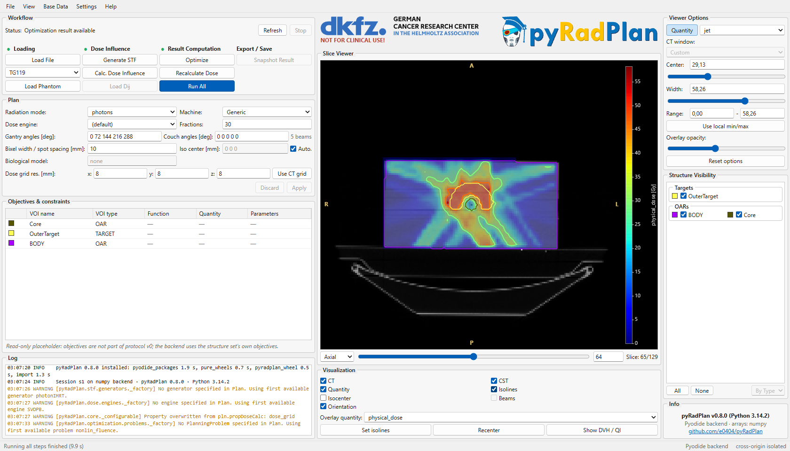
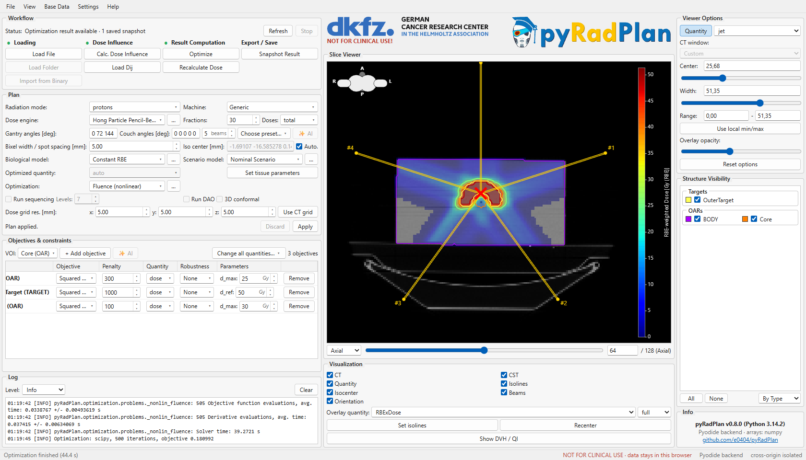

# Web prototype: pyRadPlan in the browser (decision report)

Status 2026-11-18, branch `dev/web-pyodide` (from `develop` at 66763c82). Exploratory prototype,
not reviewed for merging.

## Result

pyRadPlan runs natively in the browser. A React frontend that mimics the Qt main window loads
TG119, generates the STF, calculates the dose influence matrix, optimizes and shows the dose, all
inside a web worker running Pyodide with the numpy backend.



| Deliverable | Where | State |
|---|---|---|
| pyRadPlan on Pyodide | `web/pyodide/` (bootstrap, SimpleITK stand-in, headless harness), 4 small edits in `pyRadPlan/` | Photon and proton pipelines complete; agree with native to floating-point noise |
| Frontend | `web/` (Vite, TypeScript, React) | Workflow, plan and viewer panels work against real Pyodide and against a mock |
| Intermediate layer | `pyRadPlan/app/`, contract in `web/PROTOCOL.md` | Draft; 80 tests; used by the web frontend, not yet by the Qt GUI |

Numbers (TG119, this machine; details in `web/pyodide/FINDINGS.md`):

- Browser boot to a usable session: about 7 s with warm caches.
- 5 beams, 10 mm bixels, 8 mm dose grid: "Run All" in about 10 s in the browser.
- Pyodide is 1.5–2.3× slower than native Python with numba off.
- Cold download is about 71 MB, of which 31 MB is the bundled `.mat` data.
- Peak WebAssembly memory is 0.6–1.8 GB on TG119; 5-beam protons at 5 mm already use 1.8 GB.

## How to run

```bash
export PATH="/d/Python/pyRadPlan-web-tools/node:$PATH"     # portable Node 24, not installed system-wide
cd web/pyodide && npm install
PYTHON=D:/Python/pyRadPlan/.venv/Scripts/python.exe npm run build   # wheels into web/public/pyrp/
cd .. && npm install && npm run dev                          # open the printed URL
```

`?backend=mock` runs the UI without Python. `npm run e2e:pyodide` clicks through the real pipeline
in headless Edge and writes screenshots to `web/e2e/screenshots/` (git-ignored).

## Architecture

```
React components ── zustand store ── Backend (typed client, array codec)
                                       ├─ MockBackend (TypeScript)
                                       └─ PyodideBackend ── Web Worker ── Pyodide
                                                                            └─ pyRadPlan.app.dispatch(request, emit)
                                                                                 └─ Session ── Workspace ── pyRadPlan
SliceRenderer (WebGL2 + Canvas2D overlay), fed with volumes fetched once per change
```

## Decisions

### 1. SimpleITK: numpy/scipy stand-in outside the package

SimpleITK has no WebAssembly build, and `sitk.Image` is the storage type of CT, masks and dose in
about 55 modules. It was the only real blocker.

| Option | Pros | Cons |
|---|---|---|
| **Stand-in module `SimpleITK`, installed only in Pyodide (chosen)** | pyRadPlan unchanged; 16 kB; natively bit-identical to SimpleITK on the full photon and proton pipelines; 115 comparison tests | A second implementation to keep in sync; unknown calls fail (loudly) only in the browser; no image file IO, so no DICOM/NRRD import yet |
| Internal image type (array + `Grid`), SimpleITK only at IO | One code path, array-API friendly, removes a heavy dependency everywhere | Touches ~57 files and the public data model; a project of its own |
| Compile SimpleITK with Emscripten | Real ITK including IO | No existing build, large, rebuild per Pyodide release; not attempted |
| itk-wasm | Maintained, has IO | Different API; needs an adapter as large as the stand-in |

Reasoning: the stand-in got the whole pipeline running in hours and is testable against the real
library. If the web version becomes a product, the internal image type is the clean end state, and
the stand-in's tests document the semantics it has to keep. itk-wasm is the likely route for DICOM
import in the browser.

### 2. Packaging: wheel with `deps=False` and a pinned dependency list

micropip cannot resolve pyRadPlan's dependencies (SimpleITK; the AI stack with `safetensors`).
The bootstrap installs the Pyodide-built packages (numpy, scipy, h5py, pydantic, …), a vendored
list of pinned pure-Python wheels, the stand-in and the pyRadPlan wheel.

Alternative: mount a zipped source tree. Simpler for development, but a wheel is what a release
would ship. Alternative for later: a `web` extra or a split of core and AI dependencies in
`pyproject.toml`, so that micropip can resolve the package on its own.

Four eager imports were made lazy in pyRadPlan (matplotlib in `cst/_voi.py`, `analysis/_dvh.py`,
`analysis/_qi.py`; contourpy in `io/dicom/_export_cst.py`), which removes matplotlib (10 MB) from
the browser download. The full native suite passes with them (4216 passed, 14 skipped).

### 3. Solver, kernels, threads

- Solver: SciPy L-BFGS-B and ipax both work (ipax has a pure wheel); IPOPT is unavailable. The app
  layer picks the first available of ipopt, scipy unless told otherwise.
- numba is unavailable; the numpy code paths are used (`jit_backends = ""`).
- No threads: Pyodide runs in a web worker, so the UI stays responsive, and progress events are
  posted while Python runs. Stop uses Pyodide's interrupt buffer (needs `SharedArrayBuffer`, hence
  the COOP/COEP headers); it stopped a dose calculation within about 0.1 s.

Alternative for parallelism: several workers (one per beam) with the dij assembled in JS or via
shared memory. Not explored; memory per worker is the cost.

### 4. Intermediate layer: `pyRadPlan.app` with command dispatch

`Workspace` (observable store, same keys as the Qt `WorkspaceManager`), `Session` (workflow steps,
stage and staleness tracking extracted from `WorkflowWidget` as pure functions, plan summaries,
view data, events), `SessionManager`, and `dispatch(request, emit)`: JSON-like requests and
responses, arrays as separate binary buffers, state/progress/log events. Design notes:
`docs/development/app_layer.md`.

| Option | Pros | Cons |
|---|---|---|
| **Command dispatch with JSON + binary buffers (chosen)** | One contract for the worker today and a server (WebSocket) later; testable natively with pytest; the frontend can be developed against a mock | Every feature needs a method and a summary type; the plan/objective models are flattened by hand |
| Call Python objects from JS through Pyodide proxies | No protocol to write | Ties the UI to Pyodide and to pyRadPlan's object model; proxies leak; no server option; not usable across the worker boundary without a wrapper anyway |
| Generate the protocol from the pydantic models (JSON schema → TypeScript) | Forms and types stay in sync with the models | More machinery; worth doing once objectives and algorithm configuration are editable in the web UI |
| msgpack or Arrow instead of JSON + buffers | Compact, typed | Extra dependencies on both sides; transferable `ArrayBuffer`s already avoid copies |

The layer is Qt-free and thread-free. Each step is split into `prepare` (checks, captures inputs),
`compute` (no workspace writes) and `commit`, so the Qt GUI can run `compute` on its `QThread` and
commit on the GUI thread. The Qt GUI was deliberately not changed; the adoption path is sketched in
the design notes. A parity test replays random workspace changes on the real `WorkflowWidget` and
on the extracted rules.

State is sent as a full snapshot after each change rather than as diffs: simpler, and the state is
small. Volumes are delivered on the CT grid in `(z, y, x)` order, so the frontend never resamples.

### 5. Frontend stack

Vite, TypeScript (strict), React 19, zustand for state, hand-written CSS that follows the Qt look,
vitest and Playwright (driving the installed Edge). No UI kit: the Qt GUI is dense and
desktop-like, and a kit would have to be fought to look like it.

Pyodide's runtime is served from the npm package; the numpy/scipy wheels come from jsDelivr. A
fully self-hosted mirror can be selected by URL parameter and is what an intranet deployment needs.

### 6. Slice renderer: hand-written WebGL2 plus a Canvas2D overlay

CT and quantity are uploaded once as 3-D textures. Slicing, window/level, colormap and blending
happen in one fragment shader, so scrolling and windowing never go back to Python. Contours and
isolines are traced per slice with marching squares (the algorithm the Qt viewer uses) and drawn as
vector paths. Full comparison: `web/docs/renderer.md`.

| Option | Pros | Cons |
|---|---|---|
| **Own WebGL2 renderer (chosen)** | Exact control over the pyqtgraph look; no dependency; our own array + grid data model; about 900 lines | We own it; no ready-made 3-D or MPR tools |
| vtk.js | Volume rendering, reslicing | Large; VTK data model and interactors; hard to reproduce the Qt overlays exactly |
| Cornerstone3D | Clinical viewport tools | DICOM-centric data model; heavy; awkward for arrays coming from Python |
| NiiVue | Small, fast, multiplanar | Own interaction and overlay model; contours and isolines are not its idiom |
| Canvas2D only | Trivial | Recomputes every pixel on each scroll or window change |

vtk.js remains the suggestion for a 3-D view, next to this renderer. The shader is small enough to
port to WebGPU later.

## What is not done or not verified

- **Only TG119 was run.** No real patient, no DICOM import (needs image IO the stand-in lacks), no
  file save or export. "Load File" exists but was not tested against Pyodide with a real file.
- **Memory.** The 4 GB limit was set aside as agreed, but it is close: TG119 protons reach 1.8 GB.
  The viewer was not measured on a 512×512×300 CT; the app layer sends the CT as float32 and one
  uint8 mask volume per structure, both of which should become more compact.
- **Untested under Pyodide:** carbon, helium, VHEE, robust/scenario optimization, 4D, FSPB,
  `calc_dose_forward`. Biological-model checks in the app layer are tested with stubs only.
- **Browsers:** only headless Edge with software WebGL. No Firefox, Safari, mobile or real-GPU
  frame times.
- **Frontend gaps:** objectives table is read-only; beam overlay, Load Folder, Load Dij and result
  snapshots are missing or disabled.
- **One unexplained flake:** an early browser run ignored a "Load Phantom" click once. The test
  waits were tightened and later runs passed (four in a row including mine), but the cause was not
  found.
- **App layer is a draft:** no objective, scenario or algorithm-option editing; no persistence; no
  per-session lock; helper logic is duplicated from the GUI until the GUI imports it from here.
- **Photon results differ between native and Pyodide as much as between two native random seeds**
  when dij sampling is on, because 1–3 ulp differences in `exp`/`log` flip sampling decisions. With
  sampling off the dij agrees to 1e-7–2e-6. Target statistics agree to 0.05 % either way.
- No CHANGELOG entry and no CI job were added.

## Suggested next steps

1. Decide whether this is a demo/teaching tool (TG119-sized cases, static hosting) or a planning
   frontend. For the second, the same `dispatch` behind a WebSocket server removes the memory limit
   and brings back numba, GPUs and IPOPT, and the frontend does not change.
2. Split the phantom and machine data out of the wheel and fetch them on demand (first load drops
   from about 71 MB to about 43 MB).
3. Let the Qt GUI adopt `pyRadPlan.app` (workspace and stage rules first), so both frontends share
   one implementation.
4. Add CI: stand-in comparison tests, a Pyodide smoke run, frontend unit tests.
5. Browser file import: `.mat` first, then DICOM via itk-wasm or pydicom-only readers.

## Round 2: full mimic of the Qt GUI (2026-11-19)

The web GUI now covers the whole Qt GUI, element by element. `web/docs/parity.md` lists every Qt
element with its web status (verified on Pyodide / done against the mock / stub / n/a), and
`web/PROTOCOL.md` has a v1 section for the methods behind it.



What was added:

- **Plan widget** with all Qt fields; engine, scenario, biological model and optimization dialogs
  are generic forms rendered from descriptors that the app layer generates from the pydantic
  configuration models, so no algorithm option is hard-coded in the frontend.
- **Objectives & constraints** editing, tissue dialog, optimization status window.
- **Viewer:** beam overlay with gantry drag, orientation marker, quantity selector across results,
  per-beam and scenario components, compact mask transfer, revision-driven refetching.
- **Structure list:** grouping by type or overlap, colour, Edit VOI dialog.
- **Analysis window:** DVH with markers, QI table, compare against a snapshot.
- **Menus:** file load and save (mat, npz, pickle, zipped DICOM export) as browser downloads, base
  data dialog, preferences, licenses, about, log level, dark mode, educational mode, splash.
- **Web session profile:** dose grid 5 x 5 x 5 mm and dose convention "total" by default
  (`session.create {profile: "web"}`); a profile can lock fields, which the forms pick up. The
  native default plan (3 mm) is unchanged.
- **SimpleITK stand-in:** now reads and writes real SimpleITK's pickle format, so workspace pickles
  move between native and browser in both directions.

Changes outside `pyRadPlan/app` and `web/`: the pure-Python tissue helpers and result display-name
helpers moved from `gui/widgets/_tissue_params.py` and `gui/widgets/_display_names.py` to
`pyRadPlan/biology/_editing.py` and `pyRadPlan/quantities/_display_names.py` (re-imported by the
GUI modules; two GUI tests patch the new location).

Visible but disabled, because the browser runtime cannot do it (reasons come from
`app.info.capabilities`): image-file and DICOM import, image-file export, Monte Carlo engines,
IPOPT, GPU settings, AI features, pause/resume.

Verified (2026-11-19): 1412 Python tests (app layer, GUI, biology, stand-in), 109 frontend unit
tests, four mock browser tests, a 43-check click-through on real Pyodide (dev and production
bundle), and 62 app-layer calls under Pyodide in Node.

Measured in headless Edge with the web defaults (TG119):

| Case | Time | wasm heap afterwards |
|---|---|---|
| Boot | 10-12 s | 0.16-0.19 GB |
| Run All, default plan (1 photon beam) | 6.5-8.6 s | 0.46-0.56 GB |
| Run All, 5 photon beams | 33-38 s | 0.86-0.91 GB |
| Run All, 5 proton beams (same session) | 43-45 s | 1.9-2.0 GB |

Known problems:

- **Optimizer bug in the core, not web-specific, not fixed:** a structure whose objectives are
  emptied by its overlap priority (TG119 Core set below BODY) makes the objective NaN at iteration
  0; the optimizer stops without an error and the result is zero or the initial weights. Found by
  the browser test; reproduced natively through `dispatch`.
- The wasm heap never shrinks: photons then protons in one session reach about 1.9 GB of 4 GB.
  Large saves (a 335 MB workspace pickle at 5 beams) need that much again in the browser.
- DVH plot has no mouse zoom/pan; one analysis window at a time; the objectives table can end up
  scrolled sideways after edits.
- Helper code copied into the app layer from Qt modules (licenses, settings mirroring, beam
  geometry) still exists twice until the Qt GUI imports it from the app layer.
- Still only TG119, only headless Edge with software WebGL.
